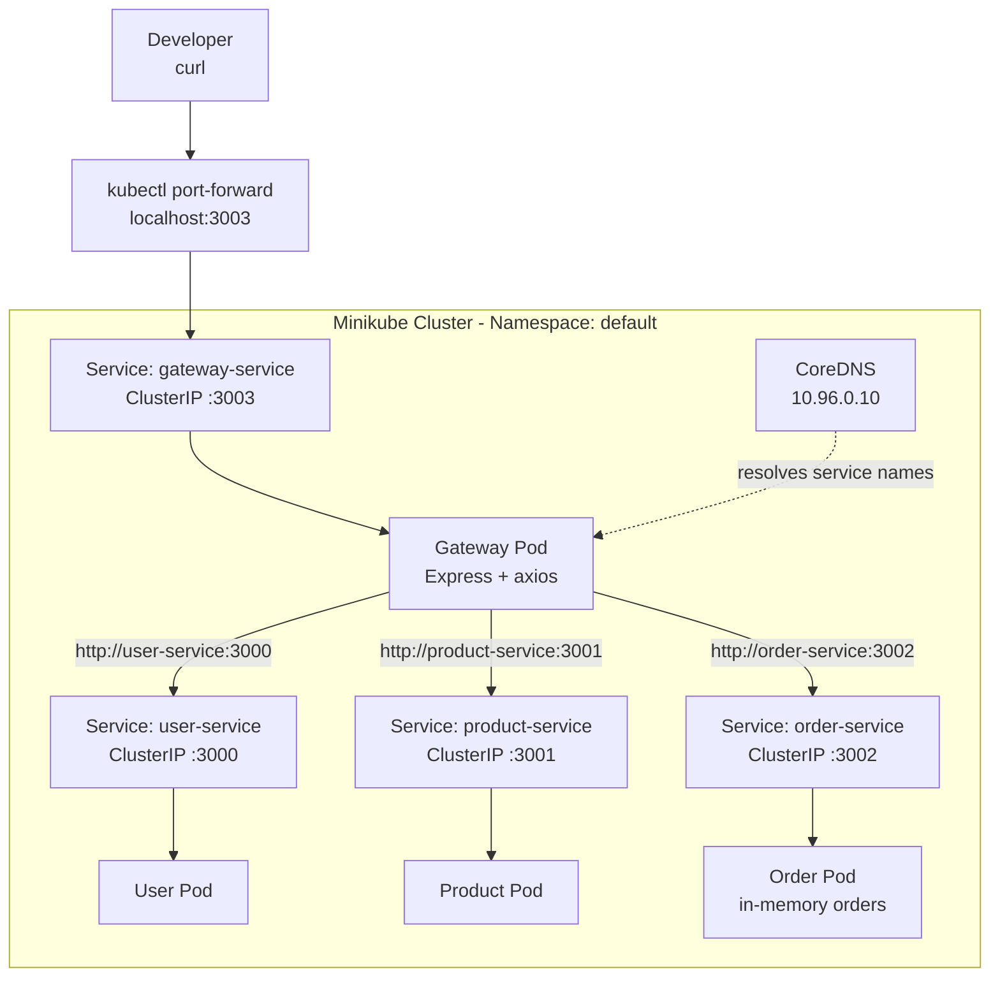
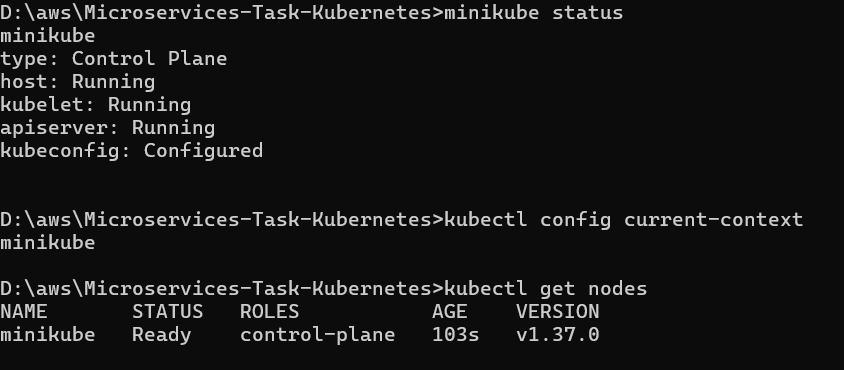
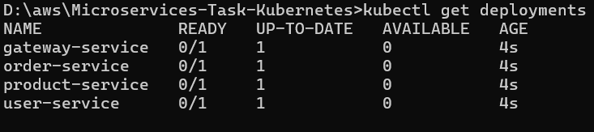
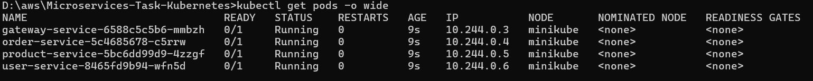
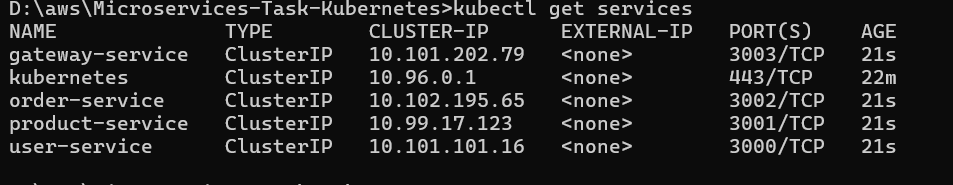
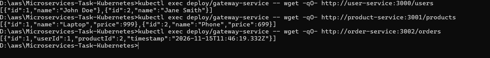
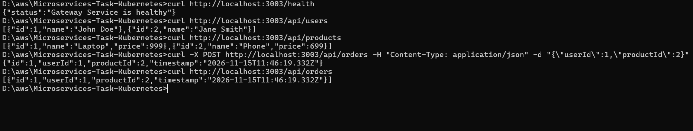
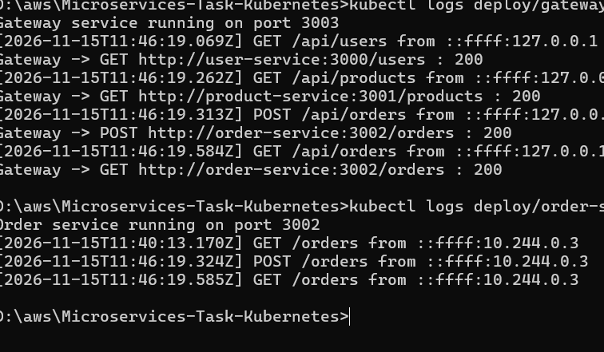

# Microservices-Task – Kubernetes Deployment on Minikube

A four-service Node.js microservices application deployed to a local **Kubernetes** cluster with **Minikube**, using **Docker, Kubernetes Deployments, ClusterIP Services, Kubernetes DNS service discovery and kubectl port-forward**.

**GitHub Repository:** https://github.com/karan11619/Microservices-Task-Kubernetes

**Cluster:** Minikube (single node, docker driver)

---

## Architecture

```text
                         ┌──────────────────────────┐
                         │        Developer         │
                         │                          │
                         │  curl → localhost:3003   │
                         └────────────┬─────────────┘
                                      │
                                      ▼
                         ┌──────────────────────────┐
                         │  kubectl port-forward    │
                         │  svc/gateway-service     │
                         │  3003:3003               │
                         └────────────┬─────────────┘
                                      │
                                      ▼
              ┌──────────────────────────────────────────┐
              │            Minikube Cluster              │
              │        Namespace: default                │
              │                                          │
              │  ┌────────────────────────────────────┐  │
              │  │ gateway-service (ClusterIP :3003)  │  │
              │  │       │                            │  │
              │  │       ├── user-service    :3000    │  │
              │  │       │     GET /users             │  │
              │  │       │                            │  │
              │  │       ├── product-service :3001    │  │
              │  │       │     GET /products          │  │
              │  │       │                            │  │
              │  │       └── order-service   :3002    │  │
              │  │             GET/POST /orders       │  │
              │  └────────────────────────────────────┘  │
              │                                          │
              │  CoreDNS: service name → ClusterIP       │
              │  Probes: GET /health on every pod        │
              └──────────────────────────────────────────┘
```

### Mermaid Architecture



---

# Application

The application consists of four Node.js (Express) microservices:

| Service | Port | Endpoints | Health |
|---|---|---|---|
| User Service | 3000 | `GET /users` | `GET /health` |
| Product Service | 3001 | `GET /products` | `GET /health` |
| Order Service | 3002 | `GET /orders`, `POST /orders` | `GET /health` |
| Gateway Service | 3003 | `GET /api/users`, `GET /api/products`, `GET /api/orders`, `POST /api/orders` | `GET /health` |

The Gateway is the single entry point. It proxies `/api/*` requests to the backend services using **axios** and the backends' Kubernetes Service DNS names.

---

# Main Deployment Steps

## 1. Verify Docker and kubectl

### Command

```powershell
docker version
kubectl version --client
```

### Output

```text
Server: Docker Desktop 4.64.0 (221278)
 Engine:
  Version:          29.2.1
  OS/Arch:          linux/amd64

Client Version: v1.34.1
Kustomize Version: v5.7.1
```

---

## 2. Install Minikube

### Command

```powershell
winget install Kubernetes.minikube
minikube version
```

### Output

```text
minikube version: v1.39.0
commit: 7a9f6a841470a207de8cf4bafcccee0969d8ba10
```

---

## 3. Start the Minikube Cluster

### Command

```powershell
minikube start --driver=docker --cpus=2 --memory=4096
```

### Output

```text
* Using the docker driver based on user configuration
* Starting "minikube" primary control-plane node in "minikube" cluster
* Creating docker container (CPUs=2, Memory=4096MB) ...
* Preparing Kubernetes v1.37.0 on containerd 2.3.4 ...
* Enabled addons: storage-provisioner, default-storageclass
* Done! kubectl is now configured to use "minikube" cluster and "default" namespace by default
```

### Verify cluster status

```powershell
minikube status
kubectl config current-context
kubectl get nodes
```

### Output

```text
minikube
type: Control Plane
host: Running
kubelet: Running
apiserver: Running
kubeconfig: Configured

minikube

NAME       STATUS   ROLES           AGE    VERSION
minikube   Ready    control-plane   103s   v1.37.0
```

### Screenshot



---

## 4. Create Dockerfiles

Each service folder contains a `Dockerfile` and a `.dockerignore`:

```dockerfile
FROM node:20-alpine
WORKDIR /app
COPY package.json ./
RUN npm install --omit=dev
COPY app.js ./
EXPOSE 3000
USER node
CMD ["node", "app.js"]
```

`EXPOSE` is `3000`, `3001`, `3002` and `3003` respectively.

---

## 5. Build Docker Images

### Command

```powershell
docker build -t user-service:1.0 Microservices/user-service
docker build -t product-service:1.0 Microservices/product-service
docker build -t order-service:1.0 Microservices/order-service
docker build -t gateway-service:1.0 Microservices/gateway-service
```

Images:

```text
user-service:1.0
product-service:1.0
order-service:1.0
gateway-service:1.0
```

---

## 6. Load Images into Minikube

The Minikube node uses **containerd** and cannot see Docker Desktop's images, so the images are copied into the node.

### Command

```powershell
minikube image load user-service:1.0 --overwrite=true
minikube image load product-service:1.0 --overwrite=true
minikube image load order-service:1.0 --overwrite=true
minikube image load gateway-service:1.0 --overwrite=true
minikube image ls | findstr service
```

### Output

```text
docker.io/library/user-service:1.0
docker.io/library/product-service:1.0
docker.io/library/order-service:1.0
docker.io/library/gateway-service:1.0
```

---

# Kubernetes Deployment

## 7. Deployment Manifests

Files:

```text
submission/deployments/user-service.yaml
submission/deployments/product-service.yaml
submission/deployments/order-service.yaml
submission/deployments/gateway-service.yaml
```

Each Deployment includes:

| Setting | Value |
|---|---|
| Image | `<service>:1.0` |
| Image pull policy | `Never` (the image was loaded locally) |
| Replicas | `1` (order-service must stay at 1 because orders are stored in memory) |
| Container port | 3000 / 3001 / 3002 / 3003 |
| Resource requests | `cpu: 50m`, `memory: 64Mi` |
| Resource limits | `cpu: 200m`, `memory: 128Mi` |
| Environment variables | `NODE_ENV=production`, `SERVICE_NAME` |
| Readiness probe | `GET /health`, initial delay 5s, period 10s |
| Liveness probe | `GET /health`, initial delay 15s, period 20s |
| Labels / selector | `app: <service>`, `tier: backend` or `gateway` |

Gateway proxy environment variables:

```yaml
- name: USER_SERVICE_URL
  value: "http://user-service:3000"
- name: PRODUCT_SERVICE_URL
  value: "http://product-service:3001"
- name: ORDER_SERVICE_URL
  value: "http://order-service:3002"
```

---

## 8. Service Manifests

Files:

```text
submission/services/user-service.yaml
submission/services/product-service.yaml
submission/services/order-service.yaml
submission/services/gateway-service.yaml
```

Every Service has `type: ClusterIP` and selects pods by `app: <service>`. It listens on `port` and forwards to the named container port `targetPort: http`.

---

## 9. Validate Manifests

### Command

```powershell
kubectl apply --dry-run=server -f submission/deployments/
kubectl apply --dry-run=server -f submission/services/
```

### Output

```text
deployment.apps/gateway-service created (server dry run)
deployment.apps/order-service created (server dry run)
deployment.apps/product-service created (server dry run)
deployment.apps/user-service created (server dry run)
service/gateway-service created (server dry run)
service/order-service created (server dry run)
service/product-service created (server dry run)
service/user-service created (server dry run)
```

---

## 10. Deploy the Application

Services are applied first, so the DNS names exist before the pods start.

### Command

```powershell
kubectl apply -f submission/services/
kubectl apply -f submission/deployments/
```

### Output

```text
service/gateway-service created
service/order-service created
service/product-service created
service/user-service created
deployment.apps/gateway-service created
deployment.apps/order-service created
deployment.apps/product-service created
deployment.apps/user-service created
```

---

## 11. Verify Deployments

### Command

```powershell
kubectl get deployments
```

### Output

```text
NAME              READY   UP-TO-DATE   AVAILABLE   AGE
gateway-service   1/1     1            1           15m
order-service     1/1     1            1           15m
product-service   1/1     1            1           15m
user-service      1/1     1            1           15m
```

### Screenshot



---

## 12. Verify Pods

### Command

```powershell
kubectl get pods -o wide
```

### Output

```text
NAME                               READY   STATUS    RESTARTS   AGE   IP           NODE
gateway-service-6588c5c5b6-mmbzh   1/1     Running   0          15m   10.244.0.3   minikube
order-service-5c4685678-c5rrw      1/1     Running   0          15m   10.244.0.4   minikube
product-service-5bc6dd99d9-4zzgf   1/1     Running   0          15m   10.244.0.5   minikube
user-service-8465fd9b94-wfn5d      1/1     Running   0          15m   10.244.0.6   minikube
```

### Screenshot



---

## 13. Verify Services

### Command

```powershell
kubectl get services
```

### Output

```text
NAME              TYPE        CLUSTER-IP      EXTERNAL-IP   PORT(S)    AGE
gateway-service   ClusterIP   10.101.202.79   <none>        3003/TCP   15m
kubernetes        ClusterIP   10.96.0.1       <none>        443/TCP    37m
order-service     ClusterIP   10.102.195.65   <none>        3002/TCP   15m
product-service   ClusterIP   10.99.17.123    <none>        3001/TCP   15m
user-service      ClusterIP   10.101.101.16   <none>        3000/TCP   15m
```

### Screenshot



---

# Service Discovery and Testing

## 14. Verify DNS Service Discovery

CoreDNS resolves each Service name to its ClusterIP.

### Command

```powershell
kubectl exec deploy/gateway-service -- nslookup user-service
```

### Output

```text
Server:         10.96.0.10
Address:        10.96.0.10:53

Name:   user-service.default.svc.cluster.local
Address: 10.101.101.16
```

The `NXDOMAIN` lines and `exit code 1` in the full output come from DNS search-domain attempts and the IPv6 lookup. They are harmless.

---

## 15. Test Individual Services Inside the Cluster

### Command

```powershell
kubectl exec deploy/gateway-service -- wget -qO- http://user-service:3000/users
kubectl exec deploy/gateway-service -- wget -qO- http://product-service:3001/products
kubectl exec deploy/gateway-service -- wget -qO- http://order-service:3002/orders
```

### Output

```text
[{"id":1,"name":"John Doe"},{"id":2,"name":"Jane Smith"}]
[{"id":1,"name":"Laptop","price":999},{"id":2,"name":"Phone","price":699}]
[{"id":1,"userId":1,"productId":2,"timestamp":"2026-11-15T11:46:19.332Z"}]
```

### Screenshot



---

## 16. Port-Forward the Gateway

Run this in a separate terminal and keep it running:

### Command

```powershell
kubectl port-forward svc/gateway-service 3003:3003
```

### Output

```text
Forwarding from 127.0.0.1:3003 -> 3003
Forwarding from [::1]:3003 -> 3003
```

---

## 17. Test the Gateway

### Command (Windows cmd)

```bat
curl http://localhost:3003/health
curl http://localhost:3003/api/users
curl http://localhost:3003/api/products
curl -X POST http://localhost:3003/api/orders -H "Content-Type: application/json" -d "{\"userId\":1,\"productId\":2}"
curl http://localhost:3003/api/orders
```

In PowerShell, use `curl.exe` instead of `curl`.

### Output

```text
{"status":"Gateway Service is healthy"}
[{"id":1,"name":"John Doe"},{"id":2,"name":"Jane Smith"}]
[{"id":1,"name":"Laptop","price":999},{"id":2,"name":"Phone","price":699}]
{"id":1,"userId":1,"productId":2,"timestamp":"2026-11-15T11:46:19.332Z"}
[{"id":1,"userId":1,"productId":2,"timestamp":"2026-11-15T11:46:19.332Z"}]
```

### Screenshot



---

## 18. Verify Inter-Service Communication in Logs

### Command

```powershell
kubectl logs deploy/gateway-service --tail=15
kubectl logs deploy/order-service --tail=10
```

### Output

```text
Gateway service running on port 3003
[2026-11-15T11:46:19.069Z] GET /api/users from ::ffff:127.0.0.1
Gateway -> GET http://user-service:3000/users : 200
[2026-11-15T11:46:19.262Z] GET /api/products from ::ffff:127.0.0.1
Gateway -> GET http://product-service:3001/products : 200
[2026-11-15T11:46:19.313Z] POST /api/orders from ::ffff:127.0.0.1
Gateway -> POST http://order-service:3002/orders : 200
[2026-11-15T11:46:19.584Z] GET /api/orders from ::ffff:127.0.0.1
Gateway -> GET http://order-service:3002/orders : 200

Order service running on port 3002
[2026-11-15T11:40:13.170Z] GET /orders from ::ffff:10.244.0.3
[2026-11-15T11:46:19.324Z] POST /orders from ::ffff:10.244.0.3
[2026-11-15T11:46:19.585Z] GET /orders from ::ffff:10.244.0.3
```

`10.244.0.3` is the gateway pod's IP. The order service received its requests from the gateway through the `order-service` DNS name.

### Screenshot



---

# 19. Code Changes Made for Kubernetes

| File | Change | Reason |
|---|---|---|
| `Microservices/*/Dockerfile` | Added | The project had no Dockerfiles |
| `Microservices/*/.dockerignore` | Added | Keep a local `node_modules` out of the image |
| `Microservices/*/app.js` | Request logging middleware that skips `/health` | Evidence of service communication in `kubectl logs` |
| `Microservices/gateway-service/app.js` | Backend URLs read from `USER_SERVICE_URL`, `PRODUCT_SERVICE_URL` and `ORDER_SERVICE_URL`, with the original values as defaults | Configuration through environment variables |

Endpoints, ports and responses are unchanged.

---

# 20. Troubleshooting

| Symptom | Fix |
|---|---|
| `ErrImageNeverPull` | The image isn't inside Minikube. Run `minikube image load <svc>:1.0` and check with `minikube image ls`. |
| Pod stays `0/1 Running` | The readiness probe is failing. Check `kubectl describe pod <pod>` and `kubectl logs <pod>`. |
| `CrashLoopBackOff` | Run `kubectl logs <pod> --previous`. |
| `OOMKilled` | Increase `resources.limits.memory`. |
| Gateway returns `Error fetching users` | Check `kubectl get endpoints` and look for `Gateway upstream error` in the gateway logs. |
| `curl: (7) Failed to connect to localhost port 3003` | The port-forward isn't running. Start it in a separate terminal. Check with `netstat -ano \| findstr :3003`. |
| `kubectl` connects to `localhost:8080` | Run `minikube start` or `kubectl config use-context minikube`. |
| kubectl 1.34 / Kubernetes 1.37 version warning | Basic commands work. Optionally use `minikube kubectl -- <cmd>`. |
| `Failing to connect to https://registry.k8s.io/` | Build images on the host and use `minikube image load`. |
| Code changes don't show up | Rebuild, run `minikube image load ... --overwrite=true`, then `kubectl rollout restart deployment/<svc>`. |

Useful commands:

```powershell
kubectl describe pod <pod-name>
kubectl get events --sort-by=.lastTimestamp
kubectl get endpoints
```

---

# 21. Cleanup

```powershell
kubectl delete -f submission/deployments/ -f submission/services/
minikube stop
minikube delete
```

---

# 22. Technology Stack

| Component | Technology |
|---|---|
| Source Control | GitHub |
| Application | Node.js 20, Express 4, axios |
| Containerization | Docker Desktop 4.64 |
| Container Runtime (node) | containerd 2.3 |
| Kubernetes | Kubernetes 1.37 |
| Kubernetes Platform | Minikube 1.39 (docker driver) |
| CLI | kubectl 1.34 |
| Service Discovery | Kubernetes DNS (CoreDNS) |
| Service Type | ClusterIP |
| Local Access | kubectl port-forward |

---

# 23. Project Structure

```text
Microservices-Task-Kubernetes/
│
├── Microservices/
│   ├── user-service/        (app.js, package.json, Dockerfile, .dockerignore)
│   ├── product-service/
│   ├── order-service/
│   └── gateway-service/
│
├── submission/
│   ├── deployments/
│   │   ├── user-service.yaml
│   │   ├── product-service.yaml
│   │   ├── order-service.yaml
│   │   └── gateway-service.yaml
│   ├── services/
│   │   ├── user-service.yaml
│   │   ├── product-service.yaml
│   │   ├── order-service.yaml
│   │   └── gateway-service.yaml
│   └── screenshots/
│       ├── minikube-status.png
│       ├── deployments.png
│       ├── pods.png
│       ├── services.png
│       ├── service-test.png
│       ├── gateway-test.png
│       └── logs.png
│
└── README.md
```

---

# 24. Submission Screenshots

### 1. Minikube Status


### 2. Deployments


### 3. Running Pods


### 4. Services


### 5. Individual Service Test


### 6. Gateway Test


### 7. Service Communication Logs


---

# 25. Final Completion Checklist

- [x] Docker and kubectl verified
- [x] Minikube installed and started
- [x] Dockerfiles created
- [x] Docker images built
- [x] Images loaded into Minikube
- [x] Deployment manifests created (image, resources, env, probes, labels)
- [x] ClusterIP Service manifests created
- [x] Gateway configured with Service DNS URLs
- [x] All Deployments 1/1 Available
- [x] All Pods Running
- [x] DNS service discovery verified
- [x] Inter-service communication verified with curl and logs
- [x] Port-forward testing completed
- [x] Screenshots captured
- [ ] Ingress (bonus, not attempted)

---

# Repository

**GitHub:** https://github.com/karan11619/Microservices-Task-Kubernetes

**Cluster:** `minikube`

